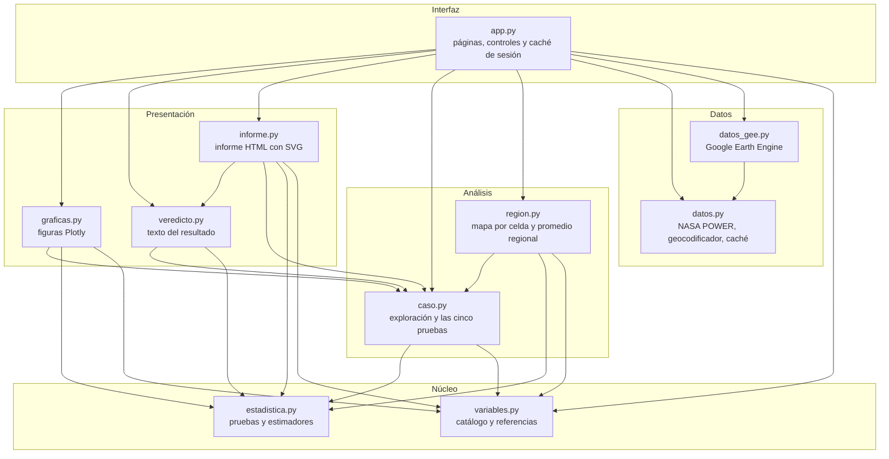
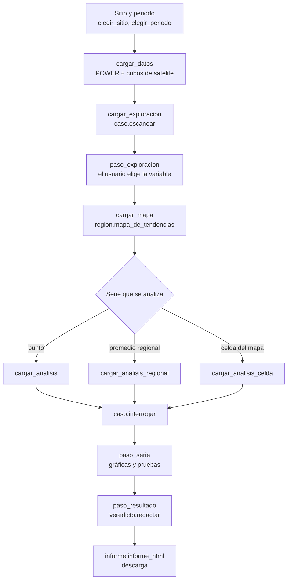
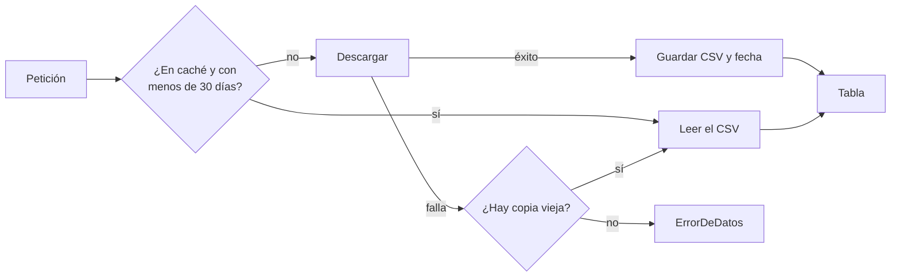

# Expediente Tierra

Herramienta para el reto "Be an Earth System Trend Detective!" del NASA Space Apps Challenge
2026, del equipo C15H25N3O. El usuario elige un lugar del planeta y la app responde qué
variable está cambiando ahí, dónde, cuánto, y si el cambio es estadísticamente significativo.

**Contenido**

1. [Correr la app](#1-correr-la-app)
2. [Arquitectura](#2-arquitectura)
3. [Árbol del repositorio](#3-árbol-del-repositorio)
4. [Vocabulario: interfaz y código](#4-vocabulario-interfaz-y-código)
5. [Objetos](#5-objetos)
6. [Procesos](#6-procesos)
7. [Módulos y funciones](#7-módulos-y-funciones)
8. [Constantes y criterios](#8-constantes-y-criterios)
9. [Datos y caché](#9-datos-y-caché)
10. [Pruebas y validación](#10-pruebas-y-validación)
11. [Método en breve](#11-método-en-breve)
12. [Limitaciones conocidas](#12-limitaciones-conocidas)
13. [Diseño y uso de IA](#13-diseño-y-uso-de-ia)

---

## 1. Correr la app

Necesitas Python 3.10 o más reciente (se desarrolló con 3.12).

En Mac, lo más fácil es hacer doble clic en `abrir.command`: la primera vez instala lo
necesario y después abre la app en el navegador. A mano, en Mac o Linux:

```bash
python3 -m venv .venv
.venv/bin/pip install -r requirements.txt
.venv/bin/streamlit run app.py
```

En Windows:

```
python -m venv .venv
.venv\Scripts\pip install -r requirements.txt
.venv\Scripts\streamlit run app.py
```

Se abre en http://localhost:8501. Los seis sitios de ejemplo funcionan sin cuentas ni
llaves, porque sus datos ya vienen guardados en `cache_power/`.

### Datos de satélite en lugares nuevos (opcional)

Las variables de reanálisis salen de la API pública de NASA POWER y funcionan en cualquier
lugar. Las de satélite (GPM, MODIS, GRACE) salen de Google Earth Engine; para verlas en un
lugar que no sea un sitio de ejemplo hace falta una cuenta con acceso a un proyecto de
Earth Engine:

```bash
SSL_CERT_FILE=$(.venv/bin/python -m certifi) .venv/bin/earthengine authenticate
export EXPEDIENTE_EE_PROYECTO=el-id-de-tu-proyecto   # si no es el del equipo
```

Sin esa sesión la app sigue funcionando y avisa que los satélites no están disponibles.

### Enlaces directos

| Ruta | Qué abre |
|---|---|
| `/` | Inicio |
| `/variables?var=T2M` | Catálogo, con la ficha de una variable al principio |
| `/analisis?caso=1&var=GRACE_AGUA&desde=2002&hasta=2024` | Análisis del sitio de ejemplo 1 (empiezan en 0) |
| `/comparacion?comp=0` | Comparación sugerida 0 |

---

## 2. Arquitectura

La aplicación tiene cinco capas. Cada capa solo conoce a las que están debajo de ella.



Reglas que el código respeta:

- **`estadistica.py` y `variables.py` no importan nada del proyecto.** El motor estadístico
  trabaja solo con arreglos de numpy y se puede probar aislado.
- **Ningún módulo de `expediente/` importa Streamlit.** Toda la lógica se puede ejecutar y
  probar sin interfaz; `app.py` es el único archivo que dibuja.
- **Los módulos de datos no conocen el análisis.** Devuelven tablas de pandas y nada más.
- **El texto del resultado sale de plantillas** (`veredicto.py`): ninguna cifra se escribe a
  mano ni la genera un modelo de lenguaje.

Servicios externos:

| Servicio | Para qué | Autenticación |
|---|---|---|
| NASA POWER (`power.larc.nasa.gov`) | Series mensuales de reanálisis, por punto y por región | Ninguna |
| Google Earth Engine | Cubos mensuales de GPM, MODIS y GRACE | Cuenta y proyecto del usuario |
| Open-Meteo Geocoding | Convertir el nombre de un lugar en coordenadas | Ninguna |
| Google Fonts y teselas de CARTO | Tipografías y mapa base | Ninguna |

---

## 3. Árbol del repositorio

```
expediente-tierra/
├── app.py                      Interfaz Streamlit: 4 páginas, controles y caché (939 líneas)
├── abrir.command               Lanzador de doble clic para Mac
├── requirements.txt            Dependencias con versión fijada
├── pytest.ini                  Configuración de las pruebas
├── README.md                   Este documento
├── .streamlit/
│   └── config.toml             Tema: colores, tipografías, barra de herramientas
├── static/
│   └── favicon.png             Ícono de la pestaña
├── expediente/                 Lógica de la aplicación (sin Streamlit)
│   ├── __init__.py
│   ├── variables.py            Catálogo de 27 variables y 27 referencias con DOI
│   ├── datos.py                NASA POWER (punto y región), geocodificador y caché
│   ├── datos_gee.py            Google Earth Engine: GPM, MODIS y GRACE
│   ├── estadistica.py          Motor estadístico: pruebas, estimadores, bootstrap
│   ├── caso.py                 Exploración de variables y análisis de una serie
│   ├── region.py               Mapa de tendencias por celda y promedio regional
│   ├── veredicto.py            Redacción del resultado, ficha técnica y avisos
│   ├── graficas.py             Figuras interactivas (Plotly)
│   └── informe.py              Informe descargable en HTML con gráficas SVG
├── tests/
│   ├── test_estadistica.py     25 pruebas del motor estadístico
│   └── test_caso.py            19 pruebas del análisis, la región y el informe
├── validacion/                 Simulaciones de Monte Carlo
│   ├── calibracion.py          Falsos positivos y potencia de cada prueba
│   ├── veredictos.py           Falsos positivos y potencia del resultado completo
│   └── series_cortas.py        Calibración con series anuales de 19 a 45 años
└── cache_power/                Datos ya descargados; crece con cada lugar consultado
    ├── descargas.json          Fecha de descarga de cada archivo
    ├── power_*.csv             Punto: todas las variables de POWER
    ├── region_*.csv            Región: una variable de POWER por celda
    └── gee_*.csv               Región de 10°: una variable de satélite por celda
```

---

## 4. Vocabulario: interfaz y código

La interfaz usa términos técnicos. El código conserva los nombres de una primera versión,
que usaba la metáfora de un detective. Esta tabla los relaciona.

| En la interfaz | En el código |
|---|---|
| Análisis de una serie | `caso.interrogar()`, que devuelve un `Interrogatorio` |
| Exploración de variables | `caso.escanear()` |
| Resultado | `veredicto.redactar()`, que devuelve un `Veredicto` |
| Prueba de significancia | `caso.Prueba` |
| Autocorrelación | "memoria" (`memoria_de_residuos`, `mann_kendall_sin_memoria`) |
| Intervalo de confianza por bootstrap | `ic_historias_alternativas` |
| Sensibilidad al periodo | `triangulo_de_ventanas` |
| Sitio de ejemplo, comparación sugerida | `EJEMPLOS`, `COMPARACIONES` |

---

## 5. Objetos

Todos son `dataclass` inmutables (`frozen=True`): se crean una vez y no cambian.

### `Variable` (`variables.py`)

Una entrada del catálogo.

| Campo | Tipo | Significado |
|---|---|---|
| `codigo` | str | Identificador: el parámetro de POWER (`T2M`) o uno propio (`GRACE_AGUA`) |
| `nombre` | str | Nombre en español que ve el usuario |
| `unidad` | str | Unidad física |
| `categoria` | str | Temperatura, Hidrología, Humedad atmosférica, Aire y viento o Vegetación |
| `definicion` | str | Definición corta, en lenguaje sencillo |
| `tecnica` | str | Definición técnica |
| `producto` | str | Producto de datos y campo del que proviene |
| `referencias` | tuple[str] | Claves de `REFERENCIAS` |
| `fuente` | str | Proveedor y vía de acceso |
| `resolucion` | str | Resolución espacial real |
| `desde` | int | Primer año que se analiza |
| `relativo` | bool | Si tiene sentido expresar el cambio en porcentaje |
| `aviso` | str | Advertencia propia de la variable |
| `origen` | str | `"power"` (reanálisis) o `"gee"` (satélite) |
| `nombre_original`, `relevancia` | propiedades | Nombre del proveedor y por qué importa la variable |

### `Referencia` (`variables.py`)

`cita` (texto completo) y `url` (enlace DOI).

### Resultados del motor estadístico (`estadistica.py`)

| Clase | Campos | Qué representa |
|---|---|---|
| `MannKendall` | `s`, `var_s`, `z`, `p`, `tau`, `n` | Resultado de una prueba de Mann-Kendall |
| `MannKendallSinMemoria` | `prueba`, `r1`, `corregida` | Mann-Kendall tras corregir la autocorrelación; `r1` es la autocorrelación estimada |
| `PendienteSen` | `pendiente`, `intercepto`, `ic_bajo`, `ic_alto` | Pendiente de Theil-Sen |
| `Regresion` | `pendiente`, `intercepto`, `p_ingenuo`, `r1`, `n`, `n_efectivo`, `p`, `ic_bajo`, `ic_alto`, `r2` | Regresión lineal y prueba t con tamaño de muestra efectivo |
| `PuntoDeCambio` | `anio`, `antes`, `despues`, `mejora`; propiedad `cambia_de_signo` | Regresión en dos tramos |

### `Prueba` (`caso.py`)

Una de las cinco pruebas de significancia, lista para mostrarse: `nombre`, `pregunta`,
`aprobada`, `resultado` (texto con el valor p) y `explicacion`.

### `Interrogatorio` (`caso.py`)

El análisis completo de una serie. Es el objeto central: lo consumen las gráficas, el
resultado y el informe.

| Campo | Significado |
|---|---|
| `variable` | La `Variable` analizada |
| `resolucion` | `"mensual"` (anomalías) o `"anual"` (promedios) |
| `serie` | Serie mensual original |
| `anomalias` | Serie mensual sin ciclo estacional |
| `anual` | Promedio de cada año |
| `t`, `y` | Tiempo en años y valores de la serie que se probó |
| `regresion` | `Regresion`: su pendiente es la tasa de cambio |
| `ic_historias` | Intervalo de confianza del 95 % de la pendiente |
| `mk`, `mk_ingenuo` | Mann-Kendall corregido y sin corregir |
| `pendiente_sen` | Pendiente de Theil-Sen, como contraste robusto |
| `triangulo`, `fraccion_ventanas` | Tendencia de cada subperiodo y fracción que conserva el signo |
| `pruebas` | Las cinco `Prueba` |
| `anios_necesarios` | Años de datos para detectar una tendencia de ese tamaño |
| `cambio` | `PuntoDeCambio`, o `None` si la serie es corta |

Propiedades calculadas: `aprobadas`, `nivel` (`solida`, `fuerte`, `indicios`, `sin`), `sube`,
`anios_de_datos`, `pendiente_decada`, `ic_decada`, `cambio_total`, `cambio_relativo` y
`cambio_en_variabilidad`.

### `Veredicto` (`veredicto.py`)

El resultado en palabras: `titular`, `cuanto`, `evidencia`, `espera`, `relevancia`,
`no_lineal`, `registro_corto` y `advertencias`. Los campos de texto quedan vacíos cuando no
aplican.

### Excepciones

| Excepción | Cuándo se lanza |
|---|---|
| `datos.ErrorDeDatos` | Una fuente no respondió o respondió algo inesperado |
| `caso.CasoImposible` | La variable no se puede analizar: menos de 15 años, o casi nunca ocurre en el lugar |

---

## 6. Procesos

### 6.1 Análisis de un lugar (`app.pagina_analisis`)



Cada función `cargar_*` está decorada con `st.cache_data`: si el usuario cambia un control,
solo se recalcula lo que depende de ese control.

### 6.2 Análisis de una serie (`caso.interrogar`)

1. Recorta la serie desde `variable.desde` y descarta los meses sin dato.
2. Calcula los promedios anuales. Si hay menos de 15 años, o un mismo valor ocupa más de
   20 % de los años, lanza `CasoImposible`.
3. Quita el ciclo estacional: a cada mes le resta el promedio de ese mes del año.
4. Decide la resolución. Si un mismo valor ocupa más de 20 % de los meses (nieve, heladas),
   analiza los promedios anuales; si no, las anomalías mensuales.
5. Ajusta la regresión lineal y estima el tamaño de muestra efectivo.
6. Calcula el intervalo de confianza de la pendiente por bootstrap.
7. Aplica Mann-Kendall con corrección de autocorrelación y calcula la pendiente de Theil-Sen.
8. Recalcula la tendencia en todos los subperiodos posibles.
9. Aplica la cuarta prueba: Mann-Kendall sobre promedios anuales, o exclusión de un año a
   la vez si la serie ya es anual.
10. Reúne las cinco pruebas, calcula los años de datos necesarios y busca el punto de cambio.

El nivel de evidencia sale de contar pruebas superadas: 5 sólida, 4 fuerte, 2 o 3 débil,
0 o 1 insuficiente.

### 6.3 Exploración de variables (`caso.escanear`)

Para cada variable del catálogo: promedios anuales, regresión lineal, tendencia
estandarizada (pendiente por década entre la desviación estándar de los residuos) y valor p
de Mann-Kendall corregido. Al final ajusta los valores p con Benjamini-Hochberg y ordena
por magnitud de la tendencia estandarizada.

### 6.4 Distribución espacial (`region.mapa_de_tendencias`)

Recibe un "cubo": una tabla con un mes por fila y una celda por columna. Para cada celda
calcula los promedios anuales, la pendiente y el valor p de Mann-Kendall corregido, y
ajusta los valores p de todas las celdas con Benjamini-Hochberg. `promedio_regional` reduce
el cubo a una sola serie, ponderando cada celda por el coseno de su latitud.

### 6.5 Descarga de datos



- **Punto** (`datos.descargar_power`): hasta 20 parámetros por petición; el valor −999 se
  convierte en dato faltante.
- **Región de reanálisis** (`datos.descargar_region`): una variable por petición, recuadro
  de 2° a 10°.
- **Región de satélite** (`datos_gee.descargar_cubo`): apila todos los meses de la colección
  en una imagen y pide de una vez una rejilla de 20 × 20 celdas de 0.5°.

### 6.6 Inicio guiado y comparación

- **Inicio** (`pagina_inicio`): el usuario elige tema, sitio e hipótesis. Se guardan en
  `st.session_state["guiado"]` y se cambia a la página de análisis. El tema decide qué
  variable se analiza primero (`TEMAS`); la hipótesis se contrasta con el resultado.
- **Comparación** (`pagina_comparacion`): ejecuta `caso.interrogar` en dos lugares con la
  misma variable y periodo, y `veredicto.comparar` redacta el resultado conjunto. Los dos
  mapas comparten la escala de color.

### 6.7 Informe descargable (`informe.informe_html`)

Arma un solo archivo HTML con portada, resumen, ficha de la variable, serie de tiempo,
pruebas, mapa, ficha técnica, contraste con la literatura, método y referencias. Las
gráficas se dibujan en SVG dentro del archivo, sin JavaScript, para que se pueda imprimir.
Todo texto que viene de fuera (nombres de lugar) se escapa antes de insertarse.

---

## 7. Módulos y funciones

Las funciones cuyo nombre empieza con guion bajo son internas del módulo.

### `expediente/estadistica.py`

| Función | Qué hace |
|---|---|
| `quitar_ciclo_estacional(serie)` | Separa una serie mensual en anomalías y climatología |
| `pares_consecutivos(t)` | Marca qué datos son vecinos inmediatos, para respetar los huecos |
| `autocorrelacion_lag1(x, pares)` | Autocorrelación de primer orden, solo entre vecinos reales |
| `memoria_de_residuos(residuos, pares)` | La anterior, corregida de sesgo y con tope en series cortas |
| `mann_kendall(x)` | Prueba de Mann-Kendall con corrección por empates y de continuidad |
| `pendiente_sen(t, y)` | Pendiente de Theil-Sen con intervalo de confianza |
| `mann_kendall_sin_memoria(t, y)` | Mann-Kendall con preblanqueo iterativo |
| `regresion_lineal(t, y)` | Mínimos cuadrados, R² y prueba t con tamaño de muestra efectivo |
| `ic_historias_alternativas(t, y)` | Intervalo de confianza por bootstrap con autocorrelación AR(1) |
| `triangulo_de_ventanas(anios, valores, largo_min)` | Tendencia y valor p de cada subperiodo |
| `anios_para_detectar(pendiente, sigma, phi)` | Años de datos necesarios para detectar una tendencia |
| `benjamini_hochberg(p)` | Ajuste de valores p por comparaciones múltiples |
| `punto_de_cambio(anios, valores)` | Regresión en dos tramos con búsqueda del año de quiebre |

### `expediente/caso.py`

| Función | Qué hace |
|---|---|
| `interrogar(serie_mensual, variable)` | Análisis completo de una serie; ver 6.2 |
| `escanear(datos, variables)` | Exploración de todas las variables; ver 6.3 |
| `promedios_anuales(serie)` | Promedio anual que no se sesga si falta algún mes |
| `numero(x, signo, cifras)` | Formato de números con cifras significativas |
| `valor_p(p)` | Formato de un valor p |

### `expediente/region.py`

| Función | Qué hace |
|---|---|
| `mapa_de_tendencias(cubo, variable)` | Tendencia y significancia de cada celda |
| `promedio_regional(cubo)` | Serie promedio de la región, ponderada por área |
| `resumen(mapa)` | Porcentaje de celdas con tendencia positiva o negativa significativa |

### `expediente/datos.py`

| Función | Qué hace |
|---|---|
| `descargar_power(lat, lon, codigos)` | Series mensuales de un punto |
| `descargar_region(lat, lon, codigo, lado)` | Serie de una variable en cada celda de un recuadro |
| `caja(lat, lon, lado)` | Límites del recuadro centrado en el punto |
| `buscar_lugar(texto)` | Coordenadas de un lugar por su nombre |
| `vigente`, `guardar_en_cache`, `leer_cache`, `fecha_de_descarga`, `fecha_de_datos` | Manejo de la caché y de sus fechas |

### `expediente/datos_gee.py`

| Función | Qué hace |
|---|---|
| `descargar_cubo(lat, lon, codigo)` | Serie mensual de un instrumento en cada celda de un recuadro de 10° |
| `recortar(cubo, lat, lon, lado)` | Celdas del cubo dentro de un recuadro más pequeño |
| `serie_del_punto(cubo, lat, lon)` | Serie de la celda más cercana al punto |

### `expediente/veredicto.py`

| Función | Qué hace |
|---|---|
| `redactar(r)` | Construye el `Veredicto` de un análisis |
| `ficha_tecnica(r)` | Periodo, tamaño de muestra, R², intervalo, α, valores p y nivel |
| `relevancia_practica(r)` | Compara el cambio con la variabilidad interanual |
| `aviso_registro_corto(r)` | Advierte si hay menos de 30 años de datos |
| `cambio_de_comportamiento(r)`, `aviso_no_lineal(r)` | Describen el punto de cambio y advierten de una inversión |
| `comparar(a, b, nombre_a, nombre_b)` | Resultado de la comparación de dos lugares |
| `informe_markdown(...)` | Versión en texto del informe; la app usa `informe.informe_html` |

### `expediente/graficas.py`

| Función | Figura |
|---|---|
| `exploracion(tabla)` | Barras con la tendencia estandarizada de cada variable |
| `serie_original(r)` | Serie mensual tal como se recibe |
| `tendencia(r)` | Anomalías, media móvil, recta e intervalo de confianza |
| `triangulo(r)` | Tendencia de cada subperiodo |
| `mapa(tabla, ...)` | Mapa de tendencia por celda |
| `comparacion(a, b, ...)` | Dos lugares sobre un mismo eje |

### `expediente/informe.py`

`informe_html(r, sitio, lat, lon, mapa, region, contraste, hipotesis, fecha_datos)` es la
única función pública. Las internas dibujan las gráficas (`_svg_serie`, `_svg_mapa`),
calculan marcas de eje y colores, y arman tablas y referencias.

### `app.py`

| Grupo | Funciones |
|---|---|
| Páginas | `pagina_inicio`, `pagina_variables`, `pagina_analisis`, `pagina_comparacion` |
| Pasos del análisis | `paso_sitio`, `paso_exploracion`, `paso_mapa`, `paso_serie`, `paso_resultado` |
| Datos con caché | `cargar_datos`, `cargar_exploracion`, `cargar_analisis`, `cargar_region`, `cargar_mapa`, `cargar_analisis_celda`, `cargar_analisis_regional`, `buscar` |
| Controles | `elegir_sitio`, `elegir_periodo`, `_buscar_sitio`, `_sitio_a_comparar` |
| Componentes | `encabezado`, `seccion`, `cifra`, `plotly`, `ficha_variable`, `definicion_emergente`, `contraste_con_literatura`, `metodo` |

---

## 8. Constantes y criterios

Las pruebas provienen de la literatura citada. Los valores de esta tabla marcados como
"criterio del equipo" son decisiones de diseño, no estándares.

| Constante | Valor | Dónde | Significado | Origen |
|---|---|---|---|---|
| `ALFA` | 0.05 | `estadistica` | Nivel de significancia | Convención |
| `TOPE_CORRECCION` | 0.15 | `estadistica` | Máximo que suma la corrección de sesgo de la autocorrelación | Criterio del equipo, validado en `series_cortas.py` |
| `N_PRUEBAS` | 5 | `caso` | Pruebas de significancia | Criterio del equipo |
| `MIN_ANIOS` | 15 | `caso` | Años mínimos para analizar | Criterio del equipo |
| `MIN_MESES` | 9 | `caso` | Meses con dato para que un año cuente | Criterio del equipo |
| `MIN_FRACCION_VENTANAS` | 0.8 | `caso` | Subperiodos que deben conservar el signo | Criterio del equipo |
| `MAX_REPETIDOS` | 0.2 | `caso` | Fracción de valores repetidos que obliga a cambiar de resolución | Criterio del equipo |
| `ANIOS_CLIMA` | 30 | `veredicto` | Por debajo se advierte "registro corto" | Periodo de referencia de la OMM |
| `DIAS_VIGENCIA` | 30 | `datos` | Días tras los que se vuelve a descargar | Criterio del equipo |
| `MAX_PARAMETROS` | 20 | `datos` | Parámetros por petición | Límite de la API de POWER |
| `LADO_CUBO`, `CELDA` | 10°, 0.5° | `datos_gee` | Tamaño y resolución de los cubos de satélite | Criterio del equipo |

---

## 9. Datos y caché

| Tipo | Fuente | Formato de la tabla |
|---|---|---|
| Punto | NASA POWER, API mensual por punto | Filas: meses. Columnas: códigos de variable |
| Región de reanálisis | NASA POWER, API mensual regional | Filas: meses. Columnas: celdas, nombradas `"lat,lon"` |
| Región de satélite | Google Earth Engine | Igual que la anterior, en rejilla de 0.5° |

Archivos de `cache_power/`:

| Patrón | Contenido |
|---|---|
| `power_{lat}_{lon}_{inicio}_{fin}_{huella}.csv` | Punto. La huella identifica la lista de variables |
| `region_{codigo}_{caja}_{inicio}_{fin}.csv` | Región de reanálisis |
| `gee_{codigo}_{caja}.csv` | Región de satélite, siempre de 10° |
| `descargas.json` | Fecha de descarga de cada archivo |

Colecciones de Earth Engine (`datos_gee.FUENTES`):

| Código | Colección | Banda | Conversión |
|---|---|---|---|
| `GPM_LLUVIA` | `NASA/GPM_L3/IMERG_MONTHLY_V07` | `precipitation` | mm/h a mm/día |
| `MODIS_NDVI` | `MODIS/061/MOD13A3` | `NDVI` | × 0.0001 |
| `GRACE_AGUA` | `NASA/GRACE/MASS_GRIDS_V04/MASCON_CRI` | `lwe_thickness` | Ninguna (cm) |

---

## 10. Pruebas y validación

```bash
.venv/bin/pip install pytest pymannkendall
.venv/bin/python -m pytest                   # 44 pruebas
.venv/bin/python -m validacion.calibracion   # falsos positivos de cada prueba
.venv/bin/python -m validacion.veredictos    # falsos positivos del resultado completo
.venv/bin/python -m validacion.series_cortas # calibración con series anuales cortas
```

Qué cubren las pruebas automáticas:

- **Cálculo contra implementaciones independientes:** Mann-Kendall contra `pymannkendall`;
  regresión y R² contra `scipy`.
- **Propiedades estadísticas:** la corrección reduce los falsos positivos; el bootstrap cubre
  la pendiente real; la fórmula de detección da 90 % de detección; las pruebas siguen
  calibradas con huecos.
- **Casos límite:** serie constante, ajuste perfecto, serie vacía, menos de 15 años,
  fenómeno que casi nunca ocurre.
- **Regresiones conocidas:** la serie de GRACE en Delhi, que una versión anterior calificaba
  mal.
- **Informe:** secciones completas y texto externo escapado.

Resultados de la validación por simulación, con series sintéticas de 45 años mensuales:

| Medida | Resultado | Series por escenario |
|---|---|---|
| Falsos positivos, Mann-Kendall sin corregir | 14 % a 64 % | 2,000 |
| Falsos positivos, pruebas corregidas | 4 % a 7 % | 2,000 |
| Falsos positivos, resultado "fuerte" o "sólido" | 3 % a 4 % | 1,500 |
| Potencia con tendencia de 0.2 σ por década | 79 % a 98 % | 1,500 |
| Falsos positivos con 19 años anuales, prueba corregida | 3 % a 13 % | 600 |

Los escenarios usan autocorrelación de 0.3, 0.6 y 0.9. La simulación usa ruido gaussiano
con autocorrelación de primer orden; no cubre memoria más larga ni distribuciones asimétricas.

Contraste con la literatura, visible en la app para los sitios de ejemplo:

| Caso | Estudio | Comparación |
|---|---|---|
| Agua almacenada, Delhi | Rodell et al. (2009) | 4.0 ± 1.0 cm por año en 2002–2008; esta herramienta da 3.8 en la misma región y periodo |
| Aerosoles, India y China | Ratnam et al. (2021) | +0.1 y −0.1 AOD por década; esta herramienta coincide en signo |
| Agua almacenada, Monterrey | Ninguno encontrado | Sin contrastar |

---

## 11. Método en breve

- **Cuánto cambia:** pendiente de mínimos cuadrados sobre la serie sin ciclo estacional,
  con intervalo de confianza por bootstrap que conserva la autocorrelación.
- **Si es significativo:** cinco pruebas. Mann-Kendall con preblanqueo iterativo
  (Zhang et al., 2000; Wang y Swail, 2001), prueba t con muestra efectiva (Santer et al.,
  2000), intervalo de confianza, repetición con promedios anuales y sensibilidad al periodo.
- **Dónde cambia:** mapa de tendencia por celda en un recuadro de 2° a 10°. Se puede
  analizar el punto, el promedio regional o una celda, en el periodo que se elija.
- **Qué variables mirar:** se exploran todas y se ordenan por tendencia estandarizada, con
  ajuste de Benjamini-Hochberg.
- **Si la tendencia cambió:** regresión en dos tramos; señala una inversión solo si los dos
  tramos son significativos y de signo opuesto.
- **Cuánto falta para detectarla:** fórmula de Weatherhead et al. (1998).

Las referencias completas están en la página "Variables" de la app y en
`expediente/variables.py`.

---

## 12. Limitaciones conocidas

- **Satélites fuera de los ejemplos.** Requieren una sesión personal de Earth Engine.
- **Región.** Solo recuadros de 2° a 10°; no hay países, cuencas ni polígonos.
- **Selección de celda.** Se elige de una lista, no con un clic en el mapa.
- **Reanálisis.** MERRA-2 puede tener saltos cuando cambian los instrumentos que asimila.
- **Aerosoles.** Provienen de CERES SYN1deg, que puede tener discontinuidades.
- **GRACE.** Su resolución real es de unos 300 km y tiene un hueco entre 2017 y 2018.
- **Tendencias no lineales.** El resultado principal es una recta; la regresión en dos
  tramos solo advierte cuando no basta.
- **Idioma.** La interfaz está solo en español.
- **Nombres internos.** El código conserva nombres de la primera versión (sección 4).
- **Pruebas de interfaz.** Se hicieron a mano; no hay pruebas automáticas de `app.py`.

No se incluyen nubosidad, radiación solar ni albedo: el producto que reparte POWER
(CERES SYN1deg) tiene saltos artificiales en esos campos cuando cambian los satélites.

---

## 13. Diseño y uso de IA

La tipografía sigue el sistema web de la NASA (Horizon Design System): Inter para títulos,
Public Sans para texto y DM Mono para cifras y etiquetas. No se usa la insignia ni el
logotipo de la NASA, cuyo uso está restringido por sus lineamientos de marca.

El código de este proyecto se escribió en su mayor parte con asistencia de inteligencia
artificial (Claude, de Anthropic), bajo la dirección y revisión del equipo. La aplicación no
usa modelos de lenguaje al ejecutarse: todos los resultados salen de cálculos deterministas.
